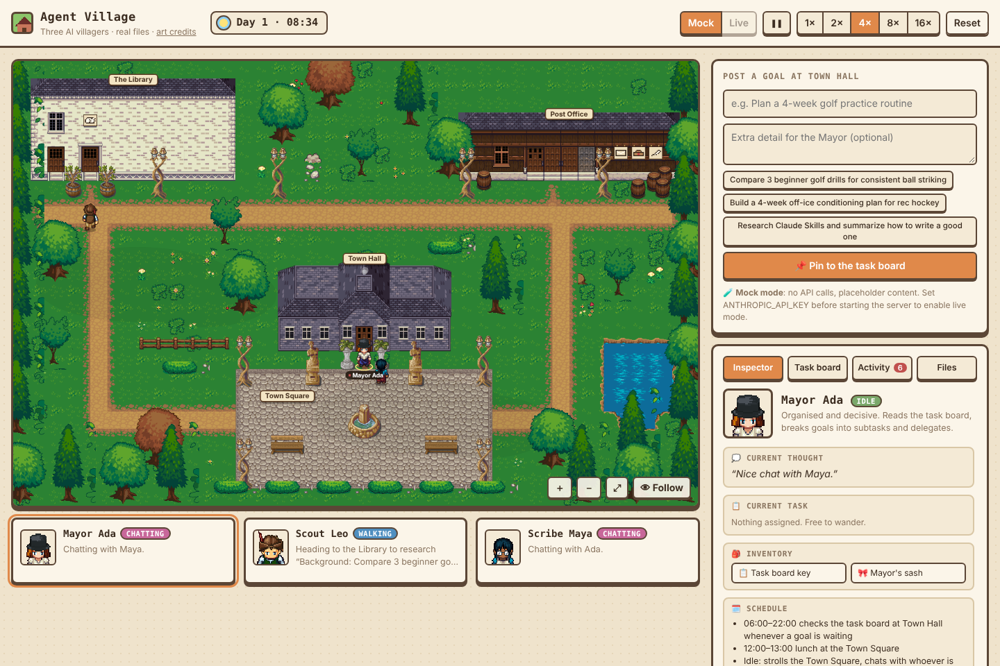

# 🏡 Agent Village

A cozy, local, top-down pixel village where three AI agents do real work.
You post a goal at Town Hall. Mayor Ada plans it, Scout Leo researches it at
the Library, and Scribe Maya writes it up at the Post Office. Each step
produces real markdown files in `workspace/`.



## Launch

```bash
cd agent-village
python3 -m venv .venv && source .venv/bin/activate
pip install -r requirements.txt
python run.py
```

Then open **http://127.0.0.1:8000**. It starts in **Mock mode**, which makes
no API calls.

For **Live mode** (real research and writing by Claude):

```bash
export ANTHROPIC_API_KEY=sk-ant-...
python run.py                       # then flip the Mock/Live toggle in the header
```

## What's in it

- **Art:** free LPC pixel art (buildings, trees, props, autotiled roads and
  water). The villagers are composited from the LPC character generator and
  have full 4-direction walk cycles. Credits are in
  [`static/assets/CREDITS.md`](static/assets/CREDITS.md). The art is
  CC-BY-SA 3.0 / GPL 3.0, licensed separately from the code.
- **Camera:** scroll to zoom, drag to pan, double-click to fit. **Follow**
  tracks the selected villager.
- **Map:** four places, each tied to a workflow.
  - Town Hall (centre): planning and delegation.
  - Library (north-west): research notes.
  - Post Office (north-east): summaries.
  - Town Square (south): idle time and chat.
  - The scenery has a fountain with spray, a pond, lamp posts, chimney
    smoke, butterflies, drifting leaves and cloud shadows.
  - A day/night cycle adds lamp light, lit windows and fireflies.
- **Agents:** each has a sprite, a schedule, an inventory, a memory log and
  a current thought.
  - States are Idle, Walking, Working and Chatting.
  - They walk roads with A* pathfinding.
  - While working, they show a progress badge.
  - When two idle villagers meet, they chat in speech bubbles.
- **Sidebar:**
  - Post goals.
  - Click any villager on the map or in the cards to open the Inspector:
    thought, task, inventory, schedule, memories and chats.
  - Task board with progress for each goal.
  - Live activity feed, filterable by chats or work.
  - File viewer for notes and summaries.
- **Controls:** pause/resume (or press Space), 1–16× speed, Mock/Live
  toggle, and Reset.
- **Storage:** SQLite (`data/village.db`) holds villager state, tasks,
  memories, chats and events. A restart resumes where you left off.

See [`CLAUDE.md`](CLAUDE.md) for the architecture, agent rules, cost
guardrails and how to add a villager.
