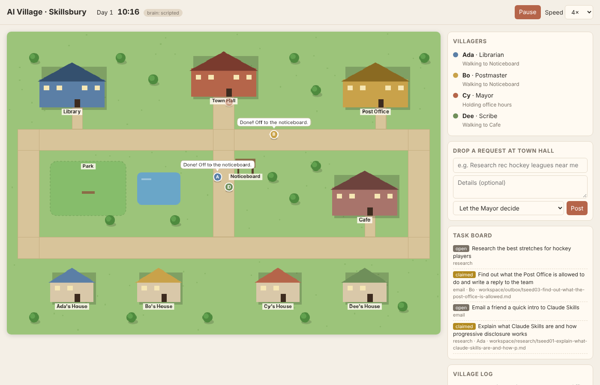

# AI Village

A small top-down village where four AI villagers do real work. Each building
is tied to a workflow: requests come in at the **Town Hall**, research happens
at the **Library**, email drafts are written at the **Post Office**, and
finished work is logged on the **Noticeboard**.



## Run it

```bash
cd ai-village
python3 server.py            # http://127.0.0.1:8765
```

No dependencies are needed for the default mode. Drop a request into the form
and watch someone walk to Town Hall, pick it up, go to the right building, do
the work, and post it on the noticeboard. The files they produce show up in
`workspace/`.

| Command | What it does |
|---|---|
| `python3 server.py --port 8765` | Web UI plus a background loop that runs the village continuously |
| `python3 run_tick.py --minutes 120` | Runs the village without the UI, for cron (see below) |
| `python3 reset.py` | Restores the seed tasks and noticeboard, and clears generated files |
| `python3 tools/render_layout.py` | Regenerates `map/village_layout.png`, the blueprint that art has to match |

## How it fits together

```
map/village.json        layout: tiles, buildings, doors, which function each building runs
villagers/              villagers.json (skills, schedule, permissions) + <id>.md personas
CLAUDE.md               shared rulebook: spending guardrails, permissions, honesty rules
village/world.py        grid + Dijkstra pathfinding (prefers paths over grass)
village/engine.py       clock, schedules, task board, building functions, persistence
village/brains.py       ScriptedBrain (free) and ClaudeBrain (opt-in, capped)
server.py               stdlib HTTP server: /api/state, /api/tasks, /api/control
static/                 canvas renderer and side panel
workspace/              the village's real files: tasks.json, library/, research/, outbox/, noticeboard.md
assets/                 drop-in art (manifest.json) + ART_BRIEF.md prompts
```

**Buildings act as functions**

| Building | Function | Reads | Writes |
|---|---|---|---|
| Town Hall | `triage`: routes untyped requests to research, email or digest | `tasks.json` | `tasks.json` |
| Library | `research`: a brief that cites its sources | `workspace/library`, `workspace/research` | `workspace/research/*.md` |
| Post Office | `email`: a draft that is **never sent** | research output from the task it depends on | `workspace/outbox/*.md` |
| Noticeboard | `log`: one line per finished task, plus a daily digest at 16:30 | task board | `workspace/noticeboard.md` |
| Cafe / Park / Homes | lunch, leisure, sleep | — | — |

**The loop:** each tick advances the clock 2 sim minutes. Each villager
follows its schedule (work, lunch, leisure, sleep). During work hours they
check the Town Hall inbox for open tasks that match their skills, walk to
the right building, work, and then post the result. Tasks can depend on each
other (`"after": "<task id>"`). For example, the seed email waits for the
research brief and then uses it. Tasks are re-read from `tasks.json` every
few ticks, so you, a script, or a Claude Code session can add work just by
editing that file.

**Design choice:** walking and schedules are deterministic. The model is only
called for content, when a task is actually done. Cost therefore grows with
the number of tasks completed, not with simulation time. If an LLM chose
every step, you would pay for thousands of calls a day just to watch dots
wander around.

## Turning on the Claude brain

```bash
pip install anthropic
export ANTHROPIC_API_KEY=...            # or `ant auth login`
VILLAGE_BRAIN=claude python3 server.py
```

| Env var | Default | |
|---|---|---|
| `VILLAGE_BRAIN` | `scripted` | `claude` to use the API for triage, research, email and digest |
| `VILLAGE_MODEL` | `claude-opus-5-5` | Set `claude-haiku-5-5` for the cheapest option |
| `VILLAGE_MAX_CALLS_PER_HOUR` | `20` | Hard cap. Over the cap, the villager falls back to the scripted brain and the log says so |

Each persona file plus `CLAUDE.md` becomes that villager's system prompt.
Triage uses structured outputs, so the route is always a valid task kind.
Refusals, rate limits and API errors all fall back to the scripted brain, so
the village never stalls.

## Real tools via Claude Code + MCP

The village can hand finished work to a headless Claude Code run, which has
access to the MCP servers you've connected (Gmail, Calendar, etc.):

```bash
VILLAGE_EXECUTOR=claude-code python3 server.py
```

This is off by default, and it only runs for buildings that list tools
explicitly in `map/village.json`. For example, to let the Post Office create
Gmail drafts:

```json
"claude_code_tools": ["mcp__Gmail__create_draft"]
```

Use the exact tool names from your own MCP setup. Only list draft or read
tools here, never send or delete tools (see `CLAUDE.md`).

## Running it on a schedule

`run_tick.py` advances the clock headless and saves state, so the UI resumes
where the cron run left off:

```cron
*/30 * * * * cd /path/to/ai-village && python3 run_tick.py --minutes 60 >> village.log
```

Don't run it while `server.py` is up, because both write `workspace/state.json`.

## Art

The village draws itself procedurally, so no art is required. To use
generated art, `assets/ART_BRIEF.md` has a prompt and size for every asset,
anchored to `map/village_layout.png`. Save the images in `assets/` and add
their filenames to `assets/manifest.json`. Any entry you leave out keeps
the procedural art.
